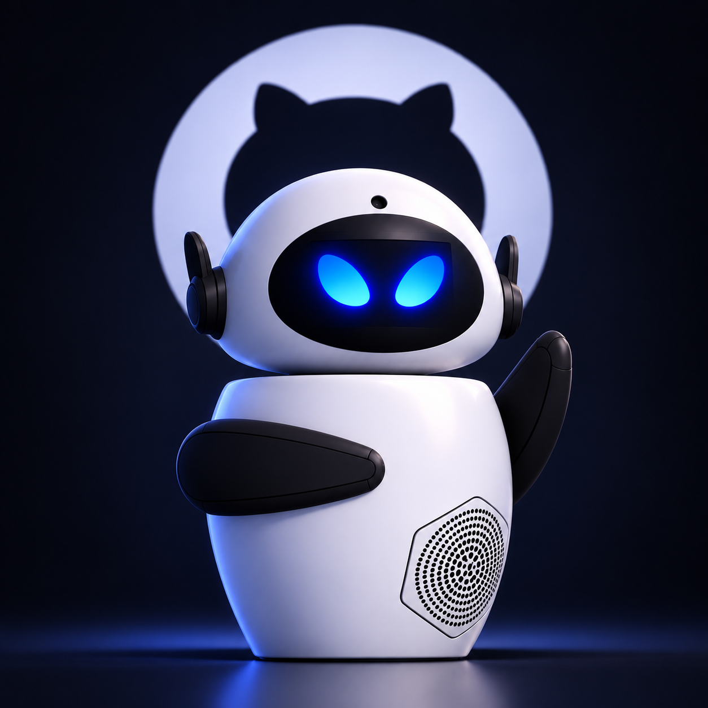

# 🤖 EVE — AI-Powered Modular Social Robot

<p align="center">
&#x20; 
</p>

<p align="center">
&#x20; <strong>A Modular Social Robot Designed for Human Interaction</strong>
&#x20; <br>
&#x20; Robotics • Artificial Intelligence • Electronics • Mechanical Design
</p>

<p align="center">
  
  
  
  
  </p>

---

## 🌟 Overview

**EVE** is a modular, AI-powered social robot designed to explore natural human–robot interaction through a combination of mechanical engineering, electronics, embedded systems, and artificial intelligence.

The project focuses on creating an interactive robotic platform capable of communicating with people through facial expressions, movement, audio interaction, and visual perception.

Unlike conventional robots with tightly integrated hardware, EVE follows a **modular architecture**. Its main components—including the processing unit, display, audio system, camera, and servo control system—are designed as independent modules that work together through standardized interfaces.

This architecture makes EVE easier to maintain, upgrade, expand, and customize.

## 🎯 Project Goals

- Develop a modular architecture for social robotics.
- Enable natural interaction between humans and robots.
- Implement expressive movements using servo motors.
- Integrate visual perception through a camera system.
- Develop audio input and output capabilities.
- Explore AI integration for intelligent interaction.
- Create an expandable hardware and software platform.

## ✨ Key Features

| Feature                 | Description                                                   |
| ----------------------- | ------------------------------------------------------------- |
| 🧠 Processing           | Raspberry Pi 4 Model B as the main computing unit             |
| 👁️ Vision              | Raspberry Pi Camera Module for visual perception              |
| 👂 Audio Input          | INMP441 digital MEMS microphone                               |
| 🔊 Audio Output         | MAX98357A I2S amplifier and speaker                           |
| 🖥️ Display             | 2.4-inch SPI TFT LCD                                          |
| 🦾 Motion Control       | PCA9685 16-channel PWM servo controller                       |
| 🤖 Expressive Movement  | Five SG90 micro servo motors                                  |
| 🧩 Modular Architecture | Independently connected hardware modules                      |
| 💻 Software             | Expandable software architecture for AI and robot interaction |

---

## 🏗️ System Architecture

EVE uses the Raspberry Pi 4 Model B (4GB RAM) as its central processing unit.

The Raspberry Pi manages the robot's main operations and communicates with peripheral modules through multiple hardware interfaces.

### Main Controller

**Raspberry Pi 4 Model B — 4GB RAM**

### Hardware Architecture

| Module           | Component                  | Interface  |
| ---------------- | -------------------------- | ---------- |
| Main Controller  | Raspberry Pi 4 Model B     | —          |
| Servo Controller | PCA9685                    | I2C        |
| Display          | 2.4-inch TFT LCD           | SPI        |
| Microphone       | INMP441                    | I2S Input  |
| Audio Amplifier  | MAX98357A                  | I2S Output |
| Camera           | Raspberry Pi Camera Module | CSI        |
| Head Movement    | SG90 Servo                 | PCA9685    |
| Left Arm         | SG90 Servo                 | PCA9685    |
| Right Arm        | SG90 Servo                 | PCA9685    |
| Left Ear         | SG90 Servo                 | PCA9685    |
| Right Ear        | SG90 Servo                 | PCA9685    |

### Modular Design

EVE is designed around independent hardware modules:

- **Processing Module:** Handles computation and high-level control.
- **Motion Module:** Controls servo motors and expressive movements.
- **Vision Module:** Provides camera-based visual input.
- **Audio Module:** Handles microphone input and speaker output.
- **Display Module:** Provides visual feedback and an interactive interface.

The modular design allows individual components to be replaced or upgraded without redesigning the entire system.

---

# 🔌 Hardware Connections & GPIO Pinout

This section documents the hardware connections between the Raspberry Pi 4 Model B and the peripheral modules used in EVE.

## 1. PCA9685 — 16-Channel PWM Servo Driver

\<details>
\<summary>\<strong>Module Description\</strong>\</summary>

The PCA9685 is a 16-channel PWM controller used to control EVE's servo motors independently.

It communicates with the Raspberry Pi through the I2C interface and generates the PWM signals required for servo positioning.

\</details>

**I2C Connections**

| PCA9685 Pin | Raspberry Pi Physical Pin | GPIO         |
| ----------- | ------------------------: | ------------ |
| VCC         |              Pin 1 (3.3V) | —            |
| GND         |               Pin 6 (GND) | —            |
| SDA         |                     Pin 3 | GPIO 2 (SDA) |
| SCL         |                     Pin 5 | GPIO 3 (SCL) |

**Servo Channel Assignments**

| Servo | Function  | PCA9685 Channel |
| ----- | --------- | --------------- |
| SG90  | Head      | CH0             |
| SG90  | Left Arm  | CH1             |
| SG90  | Right Arm | CH2             |
| SG90  | Left Ear  | CH3             |
| SG90  | Right Ear | CH4             |

**Servo Power Connections**

| Connection  | Power Source          |
| ----------- | --------------------- |
| PCA9685 VCC | Raspberry Pi 3.3V     |
| PCA9685 V+  | External regulated 5V |
| PCA9685 GND | Common Ground         |
| Servo Power | External regulated 5V |

**Important:** The Raspberry Pi must not directly power all five servos. Use an external 5V power supply with sufficient current capacity. Connect the external supply ground to the Raspberry Pi and PCA9685 grounds.

## 2. TFT 2.4-inch LCD — SPI Interface

The TFT display provides a visual interface for EVE, allowing information and graphical feedback to be displayed.

**SPI Connections**

| TFT Pin | Raspberry Pi Physical Pin | GPIO                |
| ------- | ------------------------: | ------------------- |
| VCC     |               3.3V / 5V\* | —                   |
| GND     |                     Pin 9 | —                   |
| SCK     |                    Pin 23 | GPIO 11 (SPI0 SCLK) |
| MOSI    |                    Pin 19 | GPIO 10 (SPI0 MOSI) |
| MISO    |                    Pin 21 | GPIO 9 (SPI0 MISO)  |
| CS      |                    Pin 24 | GPIO 8 (SPI0 CE0)   |
| DC      |                    Pin 22 | GPIO 25             |
| RST     |                    Pin 18 | GPIO 24             |
| BL      |                    3.3V\* | —                   |

*The supply voltage and backlight connection depend on the specific TFT breakout board. Verify its electrical specifications before connecting it.*

**Interface:** SPI0

## 3. INMP441 — Digital MEMS Microphone

The INMP441 is a digital MEMS microphone that captures audio through the I2S interface.

It provides digital audio input without requiring a separate analog-to-digital converter.

**I2S Input Connections**

| INMP441 Pin | Raspberry Pi Physical Pin | GPIO    |
| ----------- | ------------------------: | ------- |
| VDD         |              Pin 1 (3.3V) | —       |
| GND         |                    Pin 14 | —       |
| SCK (BCLK)  |                    Pin 12 | GPIO 18 |
| WS (LRCLK)  |                    Pin 35 | GPIO 19 |
| SD (DOUT)   |                    Pin 38 | GPIO 20 |
| L/R         |                       GND | —       |

**Configuration**

- Interface: I2S Digital Audio Input.
- L/R connected to GND selects the left audio channel.
- BCLK and LRCLK are shared with the audio amplifier.
- Requires an appropriately configured Raspberry Pi I2S audio interface.

## 4. MAX98357A — I2S Digital Audio Amplifier

The MAX98357A is a digital audio amplifier that receives audio data through I2S and drives the speaker.

It enables EVE to produce voice output and other audio feedback.

**I2S Output Connections**

| MAX98357A Pin | Raspberry Pi Physical Pin | GPIO    |
| ------------- | ------------------------: | ------- |
| VIN           |                Pin 2 (5V) | —       |
| GND           |                    Pin 20 | —       |
| DIN           |                    Pin 40 | GPIO 21 |
| BCLK          |                    Pin 12 | GPIO 18 |
| LRC           |                    Pin 35 | GPIO 19 |

**Speaker Connections**

| Speaker      | MAX98357A |
| ------------ | --------- |
| Positive (+) | SPK+      |
| Negative (−) | SPK−      |

**Configuration**

- Interface: I2S Digital Audio Output.
- BCLK and LRC are shared with the INMP441 microphone.
- DIN receives digital audio data from the Raspberry Pi.
- The amplifier drives the connected speaker.

**Important:** The INMP441 and MAX98357A share the I2S clock lines. Simultaneous audio input and output require compatible full-duplex I2S configuration and driver support. The speaker terminals are bridge-tied outputs; neither speaker terminal should be connected to GND.

## 5. Raspberry Pi Camera Module — CSI Interface

The Raspberry Pi Camera Module connects directly to the dedicated CSI camera connector.

| Camera Connection   | Raspberry Pi Connection |
| ------------------- | ----------------------- |
| Camera Ribbon Cable | CSI Camera Connector    |

**Applications**

- Image capture.
- Visual perception.
- Computer vision.
- Human interaction.
- Future facial detection and recognition capabilities.

The camera uses the dedicated CSI interface and does not require additional GPIO wiring.

---

## ⚡ Power Distribution

EVE uses separate power paths for the main controller and high-current servo motors.

| Component           | Power Source                       |
| ------------------- | ---------------------------------- |
| Raspberry Pi 4      | 5V USB-C Power Supply              |
| PCA9685 Logic       | 3.3V Raspberry Pi                  |
| 5 × SG90 Servos     | External Regulated 5V Supply       |
| TFT LCD             | According to Module Specifications |
| INMP441             | 3.3V Raspberry Pi                  |
| MAX98357A           | 5V Raspberry Pi                    |
| Raspberry Pi Camera | Raspberry Pi CSI Connector         |

### Grounding Requirements

- All system grounds must share a common reference.
- External servo power supply GND must be connected to Raspberry Pi GND.
- PCA9685 GND must be connected to the common ground.
- Never connect external 5V directly to Raspberry Pi GPIO pins.
- Verify the voltage requirements of each breakout board before powering it.

---

## 📍 Raspberry Pi GPIO Summary

| Physical Pin | GPIO    | Function         | Connected Module   |
| -----------: | ------- | ---------------- | ------------------ |
|            1 | 3.3V    | Power            | PCA9685, INMP441   |
|            2 | 5V      | Power            | MAX98357A          |
|            3 | GPIO 2  | I2C SDA          | PCA9685            |
|            5 | GPIO 3  | I2C SCL          | PCA9685            |
|            6 | GND     | Ground           | PCA9685            |
|            9 | GND     | Ground           | TFT LCD            |
|           12 | GPIO 18 | I2S BCLK         | INMP441, MAX98357A |
|           14 | GND     | Ground           | INMP441            |
|           18 | GPIO 24 | TFT Reset        | TFT LCD            |
|           19 | GPIO 10 | SPI MOSI         | TFT LCD            |
|           20 | GND     | Ground           | MAX98357A          |
|           21 | GPIO 9  | SPI MISO         | TFT LCD            |
|           22 | GPIO 25 | TFT Data/Command | TFT LCD            |
|           23 | GPIO 11 | SPI SCLK         | TFT LCD            |
|           24 | GPIO 8  | SPI CE0          | TFT LCD            |
|           35 | GPIO 19 | I2S LRCLK        | INMP441, MAX98357A |
|           38 | GPIO 20 | I2S Audio Input  | INMP441            |
|           40 | GPIO 21 | I2S Audio Output | MAX98357A          |

**Note:** GPIO 18, GPIO 19, GPIO 20, and GPIO 21 are used for the Raspberry Pi I2S audio interface.

---

## 🔄 Communication Interfaces

| Interface  | Protocol                    | Connected Module | Purpose               |
| ---------- | --------------------------- | ---------------- | --------------------- |
| I2C        | Two-wire Serial             | PCA9685          | Servo Control         |
| SPI        | Serial Peripheral Interface | TFT LCD          | Display Communication |
| I2S Input  | Digital Audio               | INMP441          | Audio Capture         |
| I2S Output | Digital Audio               | MAX98357A        | Audio Playback        |
| CSI        | Camera Serial Interface     | Camera Module    | Visual Input          |
| PWM        | Pulse Width Modulation      | PCA9685          | Servo Positioning     |

---

# 💻 Software Architecture

EVE uses the Raspberry Pi as its central computing platform.

The software architecture is intended to coordinate the robot's hardware modules and provide a foundation for intelligent human–robot interaction.

### Main Software Responsibilities

| System            | Responsibility                        |
| ----------------- | ------------------------------------- |
| Hardware Control  | Communication with electronic modules |
| Motion Control    | Servo positioning and movement        |
| Audio Processing  | Microphone input and audio playback   |
| Vision Processing | Camera input and image processing     |
| Display Interface | Graphical feedback                    |
| AI Integration    | Intelligent interaction capabilities  |

The software architecture is designed to support future expansion and integration of additional modules.

---

# 🛠️ Mechanical Design

EVE's mechanical structure is designed using **SolidWorks**.

The mechanical design focuses on modular construction, component accessibility, and the integration of electronic components within the robot's body.

### Design Objectives

- Modular mechanical structure.
- Accessible electronic compartments.
- Independent movement mechanisms.
- Organized internal wiring.
- Expandable hardware mounting points.

### CAD Files

The repository includes the available 3D design files and visual documentation of the robot.

---

# 📁 Repository Structure

```text
EVE/
│
├── README.md
│
├── 3D/
│   ├── CAD/
│   └── Assembly/
│
├── Code/
│   ├── Motion/
│   ├── Audio/
│   ├── Vision/
│   └── Main/
│
├── Documentation/
│   ├── Images/
│   └── Videos/
│
│
└── LICENSE
```

*The directory structure represents the intended organization of project resources. Folder contents may evolve during development.*

---

# 🚀 Development Status

\<details>
\<summary>\<strong>Project Development Roadmap\</strong>\</summary>

- [x] Initial robot concept and mechanical design.
- [x] Raspberry Pi 4 selected as the main controller.
- [x] Modular hardware architecture defined.
- [x] Peripheral module selection.
- [x] Hardware connection and GPIO documentation.
- [x] Initial working prototype.
- [x] Complete hardware integration.
- [ ] Advanced motion control.
- [x] Audio interaction development.
- [ ] Computer vision integration.
- [x] AI-powered conversational interaction.
- [x] Complete system integration and testing.

\</details>

---

# 🔮 Future Development

EVE is intended to be an expandable platform. Future development may include:

- AI-powered conversational interaction.
- Speech recognition and speech synthesis.
- Facial detection and emotion recognition.
- More expressive head and body movements.
- Improved human–robot interaction.
- Additional sensors and electronic modules.
- Advanced autonomous behaviors.

---

# 👨‍💻 Project Information

| Field                 | Details                      |
| --------------------- | ---------------------------- |
| Project Name          | EVE                          |
| Project Type          | Social Robotics              |
| Category              | AI & Robotics                |
| Main Controller       | Raspberry Pi 4 Model B (4GB) |
| Mechanical Design     | SolidWorks                   |
| Hardware Architecture | Modular                      |
| Development Status    | Working                      |
| Main Focus            | Human–Robot Interaction      |

### Designed & Developed by

**Mohammad Montazeri**
**Mahdi Montazeri**

Robotics & Mechatronics Engineering Enthusiast

---

## ⭐ Support the Project

If you find EVE interesting, consider giving this repository a ⭐ on GitHub.

Contributions, suggestions, and ideas for improving the project are always welcome.

\<p align="center">
&#x20; \<strong>Building technology that brings robots closer to humans.\</strong>
&#x20; \<br>
&#x20; \<br>
&#x20; 🤖 EVE — Explore. Build. Interact.
\</p>
